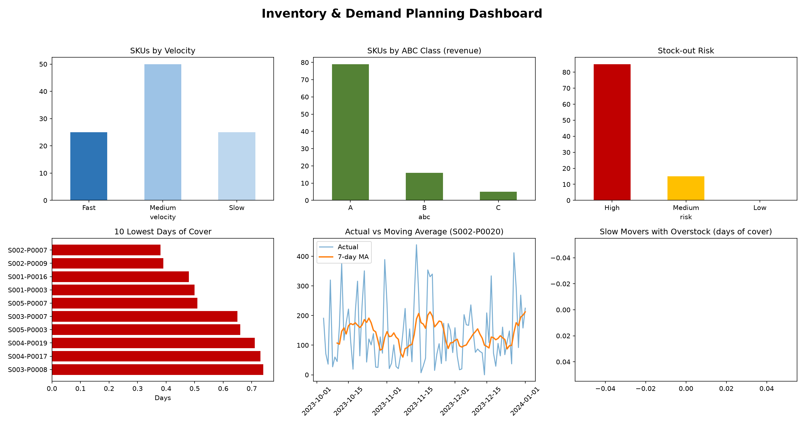
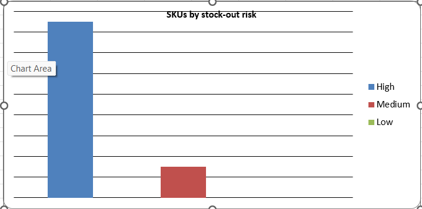
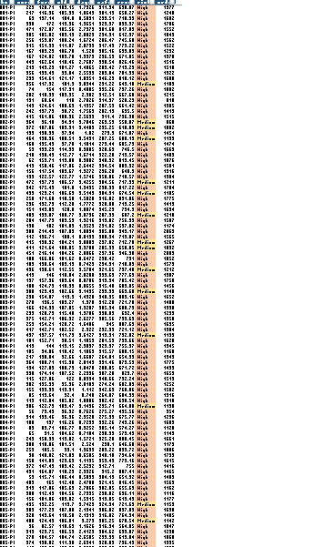

# Inventory & Demand Planning Analysis

## Objective
Identify slow- vs fast-moving SKUs, forecast 14-day demand with a
moving-average model, and flag stock-out risk. Delivered as an Excel
model with live formulas plus a dashboard.

## Dataset
Kaggle "Retail Store Inventory Forecasting Dataset" (5 stores x 20 products,
daily). SKU = Store + Product. Download the CSV and save it as
`data/raw/retail_store_inventory.csv`.

## Tools
Python (pandas, numpy, matplotlib), Excel (openpyxl, live formulas), Git/GitHub.

## Method
1. Cleaning and EDA (`01_clean_eda.py`)
2. Fast/Medium/Slow and ABC classification (`02_classify_skus.py`)
3. Moving-average forecast, 28-day backtest, WAPE (`03_forecast.py`)
4. Safety stock, reorder point, risk flag (`04_stockout_risk.py`)
5. Excel model (`05_build_excel.py`) and dashboard (`06_dashboard.py`)

## Key findings
- [N] SKUs analysed: [x] Fast, [y] Slow; [z] are class A (80% of revenue)
- Best forecast window: [7/14/28] days, WAPE [x]% vs naive [y]%
- [N] SKUs at High stock-out risk, [N] Medium, [N] overstocked
- [One finding from the EDA, e.g. promotion effect or busiest month]

## Assumptions
Lead time = [7] days (not in the dataset), service level 95% (z = 1.65).
Editable in the Assumptions sheet of the Excel model.

## Limitations
Moving average ignores trend and seasonality. Next steps: exponential
smoothing or Prophet, store-level analysis, holding-cost estimate.

## How to run
pip install -r requirements.txt
python src/01_clean_eda.py
python src/02_classify_skus.py
python src/03_forecast.py
python src/04_stockout_risk.py
python src/05_build_excel.py
python src/06_dashboard.py

## Results

